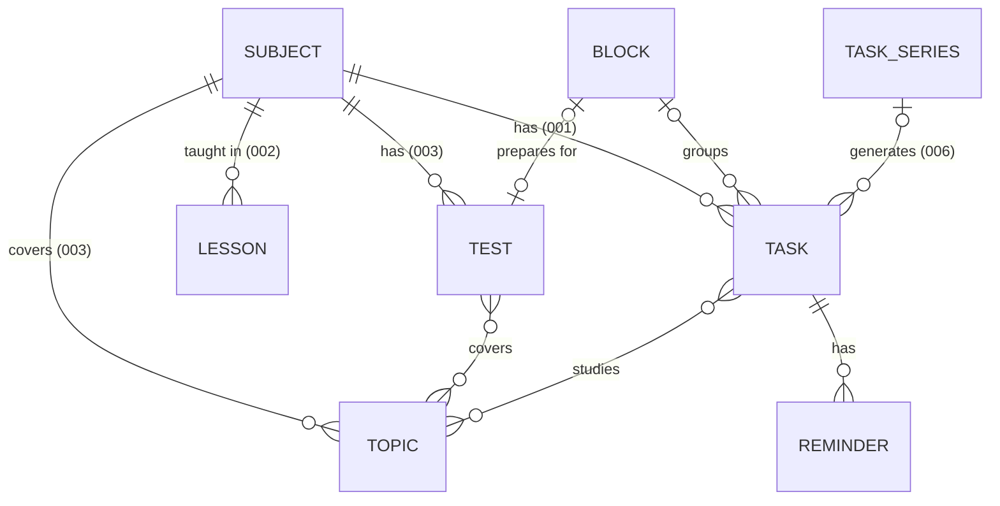

# ADR-0004: The core domain model — one task entity, days as calendar days, plain values for the domain package

- **Status:** accepted
- **Date:** 2026-11-03
- **Deciders:** Maintainer
- **Supersedes:** —
- **Superseded by:** —

## Context

Iteration 001 stores the first data: subjects and homework. Later iterations
add the timetable and the daily check-in (002), topics, tests and study
sessions with reminders (003), the timeline and burn-down (004), points and
streaks (005), and recurring tasks and routine blocks (006). Under ADR-0003,
stored models can always gain entities and attributes, but once iCloud sync
is in production nothing can be renamed, retyped or removed. So the shape of
what 001 stores must already fit what comes later, even though most of it is
built later.

Forces that are real:

- **The language of the domain** in `docs/vision.md`: subject, lesson, topic,
  test, study session, task, block, check-in, points and streak.
- **ADR-0002**: the rules live in `SchulplanerKit`, which cannot see the app.
  This ADR settles what the package sees of the data.
- **ADR-0003**: SwiftData, with no unique constraints, every property
  optional or defaulted, optional inverse relationships, a stable
  `id: UUID` per entity, a versioned schema, add-only after sync goes to
  production. Its defects are a known risk.
- **Deterministic tests** (`.claude/rules/process/quality.md`): rules get
  "now" and the calendar passed in.
- **School days are days.** Homework is due "on Thursday", not at an instant.
  An instant stored for it would shift with time zones and daylight saving.

## Decision drivers

- What 001 stores never has to be reshaped for 002–006.
- One place for everything that is "something to do": list, timeline,
  burn-down, reminders, recurrence and rewards each work once.
- Rules that run and are tested without SwiftData.
- One source of truth per fact; nothing stored that can be derived.

## Options considered

### Homework and study sessions

#### Option A: One `Task` entity with a kind

Homework, study sessions and other tasks are one entity with a `kind`.
Attributes that only one kind uses — the topics of a study session — stay
empty for the others.

- Good: lists, timeline, burn-down, reminders, recurrence and points are
  written once.
- Bad: some attributes are meaningful for one kind only; the rules have to
  know which.

#### Option B: Separate entities per kind

- Good: each entity carries exactly its own attributes.
- Bad: everything shared — completion, due day, reminders, recurrence, the
  timeline — is built and tested once per kind, and every new kind repeats it.

### Points and streaks

#### Option C: Derived from completion times

Points and streaks are computed from when tasks and check-ins were done, by
rules in the package.

- Good: one source of truth; ticking a task back to open corrects everything
  by itself.
- Bad: changing a rule changes past points too — unless the rule is
  versioned by date.

#### Option D: Stored as a ledger of awards

- Good: past points are fixed when awarded.
- Bad: every completion, undo and edit must add or reverse awards correctly;
  ledger and tasks can drift apart, and sync can duplicate entries.

### Recurring tasks

#### Option E: A series materialises single tasks

A `TaskSeries` holds the rule and the template; it creates ordinary `Task`s
for a horizon of weeks ahead, which are topped up as time passes.

- Good: each occurrence is an ordinary task — ticked, moved, reminded and
  shown in timeline and burn-down like any other.
- Bad: the app must keep the horizon filled, and a change to the series must
  decide what happens to occurrences already created.

#### Option F: Only the rule is stored; occurrences are computed

- Good: little data; changing the rule changes all future occurrences at once.
- Bad: completion, moves and exceptions per occurrence need their own
  bookkeeping beside the rule — a second model of tasks.

### What the domain package sees

#### Option G: Plain values

The SwiftData models live in the app. For each rule, the package defines the
plain values it needs — for "what is due when", for example, the due day and
the completion time of each task — and the app translates its models into
them.

- Good: the rules run and are tested without SwiftData, so its defects
  cannot reach them; the package stays a pure function of its inputs.
- Good: each rule states exactly what it depends on.
- Bad: translation code in the app, which needs its own tests.

#### Option H: The package uses the SwiftData models directly

- Good: no translation.
- Bad: every rule and every test of the package depends on SwiftData and
  needs a model container; storage defects reach the rules.

## Decision

We choose **one `Task` entity with a kind (A)**, **points and streaks
derived from completion times (C)**, **series that materialise single tasks
(E)**, and **plain values for the domain package (G)** — decided with the
maintainer in chat.

A writes every "something to do" feature once. C keeps one source of truth
and makes undo free; versioning the rule by date answers its one weakness. E
makes an occurrence an ordinary task, so nothing downstream needs to know
about recurrence. G keeps the most important code of the product independent
of the storage framework whose defects ADR-0003 names as the risk, at the
price of translation code that is simple and testable.

### The model

Entities, their essential attributes, and the iteration that builds them.
Every entity also has `id: UUID` and follows ADR-0003.

| Entity | Built in | Essential attributes |
| --- | --- | --- |
| `Subject` | 001 | name, colour key, symbol name, sort index, created at |
| `Task` | 001 | kind (`homework`, `studySession`, `other`), title, due day, completed at (optional), created at; later: scheduled start, block, topics, series, occurrence day |
| `Lesson` | 002 | weekday, start and end as minutes after midnight, week pattern |
| `CheckIn` | 002 | day, completed at |
| `Reminder` | 002/003 | offset in minutes before the task's scheduled start or due day, style |
| `Topic` | 003 | title, notes, created at |
| `Test` | 003 | kind (class test, vocabulary test, other), day, title |
| `Block` | 003/006 | kind (`testPrep`, `routine`), start day, end day, title |
| `TaskSeries` | 006 | recurrence rule, template, until day |

### Rules for the model

1. **Days are calendar days.** A due day, a test day or the day of a check-in
   is stored as `YYYY-MM-DD` and handled in the package as a calendar-day
   value, never as an instant. Instants — completed at, created at, a
   scheduled start — are stored as dates. Lessons store wall-clock minutes
   after midnight.
2. **Kinds are stored as strings.** Each `kind` is the raw value of an enum in
   the package. A value the app does not know — written by a newer version on
   another device — is read as `other` and never rewritten.
3. **Derived, not stored.** Points, streaks, "which topic was learned when"
   (from completed study sessions and their topics), and every burn-down are
   computed by the package from tasks, check-ins and their completion times.
   A rule that awards points carries the date it took effect, so that history
   is computed with the rule that was valid at the time.
4. **Deleting.** Deleting a subject deletes its tasks, lessons, topics and
   tests, after the app has asked (#10). Deleting a task deletes its
   reminders. Deleting a topic, a block or a series removes the link from its
   tasks but keeps the tasks; whether a block or series also takes its open
   tasks along is decided when 003 and 006 build them.
5. **Built when needed.** An iteration adds the entities and attributes it
   uses, and no others. 001 builds `Subject` and `Task` with the attributes
   marked 001.

### The boundary between app and package

- The **app** holds the SwiftData models and translates them into the plain
  values each rule of the package asks for, and the rule's result back.
  Translation is tested in the app's tests.
- The **package** holds the vocabulary — calendar day, task kind and the
  other enums — and the rules: pure functions of plain values, "now" and a
  calendar. It does not import SwiftData.
- Values are defined by the rule that needs them, not as a mirror of the
  stored models.

## Consequences

- Easy: every feature that deals with "something to do" handles homework,
  study sessions and recurring tasks at once; undo, history and rewards need
  no bookkeeping; the rules are tested in seconds without a store.
- Hard: translation code between the app's models and the package's values
  for each rule; attributes that only one kind of task uses; keeping the
  horizon of a series filled.
- Committed to: calendar days as `YYYY-MM-DD`, kinds as strings, and the
  entities and relations above — they become hard to change once sync is in
  production.
- Committed to: `SchulplanerKit` without SwiftData. ADR-0002's check that it
  imports no UI framework can grow to cover SwiftData too.
- Revisit if the translation code grows larger than the rules it feeds, if
  one kind of task needs so many attributes of its own that the others are
  mostly empty, or if computed points become slow enough to notice.

## Follow-up

- #10, #11 and #12 build `Subject` and `Task` as defined here; their
  acceptance criteria already refer to this ADR. The due-day default (#11)
  and the grouping by due day (#12) are rules in the package that receive
  calendar days.
- The check of #7 that `SchulplanerKit` imports no UI framework also covers
  SwiftData.
- Lessons and check-ins (002), topics, tests, blocks and reminders (003),
  points and streaks (005) and series (006) are built by those iterations
  when they are planned, as listed in `docs/iterations/README.md`.
