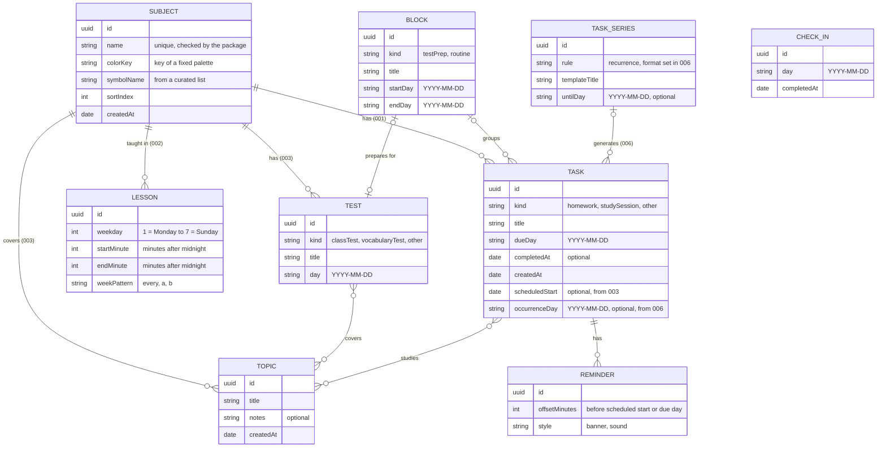

# Architecture

Derived from the accepted ADRs in [docs/adr/](adr/README.md) and updated in
the same pull request that accepts one. Where this document and an ADR
disagree, the ADR wins.

## Platform

A native iPhone app in Swift 6 and SwiftUI, for iOS 18 and later
([ADR-0002](adr/0002-native-swiftui-app-for-ios-18-with-a-local-domain-package.md)).
APIs of newer iOS versions are used behind availability checks with a
fallback. Bundle identifier `io.github.nicoschmidt.schulplaner`.

No dependencies beyond Apple's frameworks; a third-party package needs its
own ADR and an entry on the allowlist that CI checks.

## Structure

```
┌──────────────────────────────────┐
│  App (Xcode project)             │  screens (SwiftUI), storage,
│                                  │  notifications — shows and stores
└────────────────┬─────────────────┘
                 │ depends on
┌────────────────▼─────────────────┐
│  SchulplanerKit (Swift package)  │  domain logic — decides:
│  no SwiftUI, UIKit or SwiftData  │  due dates, plans, scores
└──────────────────────────────────┘
```

- **App** — the Xcode project. It holds the screens and the SwiftData models,
  and translates the models into the plain values each rule of the package
  asks for. Its tests run with `xcodebuild test`.
- **SchulplanerKit** — a local Swift package in this repository. It cannot
  see the app; anything that decides a date, an order, a plan or a score lives
  here, as pure functions of plain values, "now" and a calendar, with Swift
  Testing tests that run with `swift test`. It does not import SwiftData
  ([ADR-0004](adr/0004-one-task-entity-days-as-calendar-days-plain-values-for-the-domain-package.md)).

## Storage

SwiftData, on the device
([ADR-0003](adr/0003-store-data-with-swiftdata-in-a-cloudkit-compatible-model.md)).
iCloud sync is off until iteration 007; then it syncs through the private
database of the container `iCloud.io.github.nicoschmidt.schulplaner`, and
nowhere else. Until then, the iPhone's own backup covers the data.

Every stored model is ready for sync from its first version:

- no unique constraints; uniqueness rules are checked by the domain logic
- every property optional or with a default; every relationship optional,
  with an inverse, never `deny`; order as an explicit sort value
- every entity has a stable `id: UUID`
- the models live in a versioned schema with a migration plan; each change
  adds a version and a migration test; once the CloudKit schema is in
  production, changes are add-only
- tests use in-memory stores

## Domain model

([ADR-0004](adr/0004-one-task-entity-days-as-calendar-days-plain-values-for-the-domain-package.md))



`CheckIn` (002) stands alone: one per day the student completed the
check-in. The number in brackets is the iteration that builds the relation;
an iteration adds only what it uses. Built so far: nothing — `Subject` and
`Task` come with iteration 001.

Types are those of the stored model; `date` is an instant, and days are
strings in the format given. Lines are SwiftData relationships — there are
no foreign-key attributes. `id` is a stable identity that never changes, not
a database key: ADR-0003 rules out unique constraints.

- **One `Task`** for everything to do, with a kind: homework, study session,
  other.
- **Days are calendar days**, stored as `YYYY-MM-DD`; instants (completed at,
  created at, scheduled start) are dates; lessons use minutes after midnight.
- **Kinds are strings**; an unknown value reads as `other`.
- **Derived, not stored**: points, streaks, which topic was learned when, and
  every burn-down are computed in the package from completion times. Point
  rules carry the date they took effect.
- **Recurring tasks** are ordinary tasks that a `TaskSeries` creates for a
  horizon of weeks ahead.
- **Deleting a subject** deletes everything that belongs to it; deleting a
  topic, block or series keeps its tasks and removes the link.
